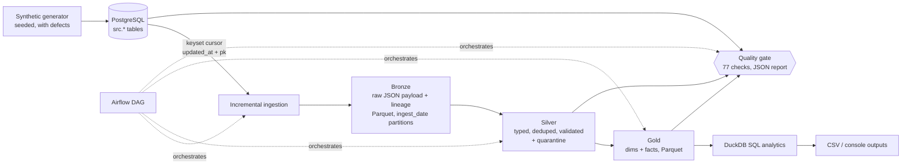

# SaaS Product Analytics Data Platform

An end-to-end, local Data Engineering project: a synthetic SaaS business writes to **PostgreSQL**; a Python pipeline ingests it incrementally into a **Bronze → Silver → Gold** lakehouse of **Parquet** files; **DuckDB** SQL produces product and revenue analytics; **Airflow** orchestrates; **pytest** and **GitHub Actions** keep it honest.

> **Status of verification** (see [Verification status](#verification-status)): the Python pipeline, SQL and 31 tests were run for real. Docker Compose, Airflow, the PowerShell scripts and the GitHub Actions workflow are written but **not yet executed** by the author of this repo's first version.

## Business problem
A SaaS company needs trustworthy answers to: How many people use the product (DAU/MAU)? How many sign-ups convert? What is MRR and why did it move? Who churns? Which plans earn and engage most? Source data is messy (duplicate and late events, bad timestamps, schema changes), so the platform must be replayable, idempotent and loud about quality failures.

## Key features
- Deterministic synthetic data generator (seeded, configurable size) that injects realistic defects.
- Incremental ingestion with a `(timestamp, primary key)` keyset cursor, safe to rerun.
- Immutable Bronze (raw JSON payload + lineage), validated Silver with a **quarantine** table and rejection reasons, dimensional Gold.
- 77 automated data-quality checks per run, written to a JSON report; error-severity failures fail the run.
- MRR waterfall (new / expansion / contraction / churn), churn, retention cohorts, conversion, revenue vs. cash by plan.
- Airflow DAG with retries, parallel ingest tasks and a quality gate; no business logic in the DAG.

## Architecture


## Technology stack
Python 3.10+ (pandas, pyarrow), PostgreSQL 16, DuckDB, Parquet, Apache Airflow 2.9 (Docker), Docker Compose, pytest, ruff, GitHub Actions. Versions are bounded in `pyproject.toml`; the exact versions the tests ran with are in `requirements-lock.txt`.

## Repository structure
```
saas_platform/      config, db, schema (+ sql/ddl.sql), generator, loader, ingestion, bronze, silver, gold, quality, analytics, pipeline, cli
saas_platform/sql/gold/        Gold models (one SELECT per table, documented grain)
saas_platform/sql/analytics/   Business queries (commented logic)
dags/               Airflow DAG (thin wrappers)
tests/              31 tests: unit + PostgreSQL integration
scripts/            PowerShell scripts (+ Makefile for Linux/macOS), benchmark.py
docs/               data_model, runbook, design_decisions, benchmark, sample_outputs
```

## Prerequisites
Windows 11 (or Linux/macOS), Python 3.10+, Docker Desktop (for PostgreSQL/Airflow), Git.

## Local setup (PowerShell)
```powershell
git clone <your-repo-url>; cd saas-product-analytics-platform
.\scripts\setup.ps1        # venv + deps + .env (random local password) + PostgreSQL container + schemas
```
If PowerShell blocks scripts: `Set-ExecutionPolicy -Scope Process -ExecutionPolicy Bypass`.
Linux/macOS: `make setup`.

## End-to-end execution
```powershell
.\scripts\run_demo.ps1     # batch 1 (day 0-90) -> run -> batch 2 (+schema change, late data) -> run -> no-op rerun -> analytics
.\scripts\test.ps1         # ruff + pytest (REQUIRE_POSTGRES=1)
.\scripts\airflow_up.ps1   # optional: Airflow UI at http://localhost:8080 (admin/admin, local only)
.\scripts\clean.ps1        # delete generated data layers (-Full also resets DB; -Down [-Volumes] stops containers)
```
Individual commands: `python -m saas_platform {init-db|generate|ingest|silver|gold|quality|analytics|run|reset}`.

## Sample analytics output
Real output from the demo run (seed 42, 500 users, 120 days). More in [docs/sample_outputs.md](docs/sample_outputs.md).

| month | new_mrr | expansion | contraction | churned | ending_mrr |
|:--|--:|--:|--:|--:|--:|
| 2025-01 | 5,522 | 0 | 0 | 0 | 5,522 |
| 2025-02 | 4,376 | 470 | 0 | 0 | 10,368 |
| 2025-03 | 5,399 | 550 | -200 | -357 | 15,760 |
| 2025-04 | 4,172 | 340 | 0 | -811 | 19,461 |

(Synthetic data: the numbers illustrate the pipeline, not a real business.)

## Data model and business definitions
Full detail in [docs/data_model.md](docs/data_model.md).
- **Active user**: distinct user with ≥1 accepted event on the day (DAU) / month (MAU). Quarantined events do not count.
- **Conversion**: user whose first paid subscription started ≤30 days after signup. Trials are not conversions. Recent cohorts are flagged `window_complete=false`.
- **MRR**: sum of monthly price of paid subscriptions that are active at that moment, derived from the subscription lifecycle (not from payments). Trials = 0. Refunds and failed payments do not change MRR.
- **Churn**: logo churn = subscriptions canceled in month ÷ paying subscriptions at month start; revenue churn = churned MRR ÷ MRR at month start (gross, excludes expansion).
- **Gross payment volume ≠ revenue ≠ MRR**: `gross_payments` = successful charges, `refunds` = successful refunds, `net_cash` = difference. Cash is reported separately from MRR and never summed with it.

## Data quality rules
Checks in `saas_platform/quality.py`, per run: uniqueness (silver + gold grains), not-null, accepted values, referential integrity, source→bronze and bronze→silver(+quarantine) reconciliation, MRR-movement-to-subscription reconciliation, row counts, rejected-record rate (≤ `QUARANTINE_MAX_RATE`), freshness (cursor lag + last-run age), duplicate processing (warn). Output: `data/quality/latest.json` and `quality_report_<run_id>.json`. Any failed **error** check raises `QualityGateError` (CLI exit code 1, Airflow task failed).

## Incremental processing and idempotency
- **Cursor**: `WHERE (updated_at, pk) > (last_wm, last_pk) ORDER BY updated_at, pk LIMIT n`. Ties on timestamps are safe because pk breaks them. Events use `received_at`, so a late-arriving event (old `event_ts`) is still picked up.
- **At-least-once, then dedupe**: the Parquet file is written atomically *before* the cursor advances. Batch ids are a hash of the cursor range, so a retry overwrites the same file instead of duplicating it.
- **Silver and Gold are deterministic full rebuilds from Bronze**, so reruns produce identical output (tested by comparing DataFrames), and late data lands on its true event date.
- **Schema drift**: extra source columns are tolerated and recorded (Bronze stores the whole row as JSON); missing required columns raise `SchemaDriftError` and the cursor is not advanced.

## Testing and benchmark methodology
31 tests (`pytest`): generator determinism and defects; Silver rules (dedup, late flag, mixed timestamp formats, validation reasons); ingestion (incremental, same-timestamp ties across batches, crash before cursor commit, retry without duplicate files, additive vs. breaking schema change); end-to-end pipeline, idempotent rerun, duplicate event, late-arriving event, quality-gate failures, empty source; hand-calculated MRR / churn / cash / conversion on a tiny dataset.
`python scripts/benchmark.py` runs a full reset→generate→load→pipeline at two sizes. Latest result ([docs/benchmark.md](docs/benchmark.md)), measured in a 1-vCPU, 4 GB Linux sandbox with a local PostgreSQL, single run, untuned:

| users | source rows | pipeline total (first run) | rerun, no new data |
|--:|--:|--:|--:|
| 500 | 12,329 | 0.92 s | 0.52 s |
| 3,000 | 73,385 | 3.52 s | 2.00 s |

These are small-data indicative numbers, **not** throughput claims for production volumes.

## Known limitations
- Silver/Gold are full rebuilds: simple and idempotent, but cost grows with total history (fine to ~millions of rows; beyond that, make Silver incremental by partition).
- A source transaction that commits late with `updated_at` ≤ the stored cursor is missed (needs a lookback window or a sequence/CDC feed).
- Deletes in the source are not captured. Mutable-table history in Bronze is append-only versions.
- One paid subscription per user at a time is assumed in plan attribution.
- Single currency (USD), monthly billing only; no proration, tax, trials-to-paid transition modeling.
- Quarantine rate threshold and freshness window are simple fixed thresholds.

## Security considerations
Only synthetic data. Credentials come from environment variables / `.env` (git-ignored); `.env.example` has a placeholder; `setup.ps1` generates a random local password. Postgres is exposed on localhost only for development; the Airflow `admin/admin` account is for local use and must be changed for anything shared. All SQL uses parameters (identifiers come from internal constants).

## Troubleshooting
- *`connection refused`*: `docker compose ps`; wait for `postgres` to be healthy; check `PGPORT` is free.
- *`password authentication failed`*: the Postgres volume keeps its first password. Either fix `.env` or `docker compose down -v` (deletes DB data) and rerun setup.
- *Quality gate failed*: open `data/quality/latest.json`, read `failed_error_checks`; `freshness_lag` means rerun `ingest`; reconciliation failures mean Bronze/Silver are out of sync, rerun `run`.
- *`SchemaDriftError`*: a required source column disappeared; restore it or update the contract in `schema.py` deliberately.
- *PowerShell script blocked*: see ExecutionPolicy note above.

## Verification status
| Area | Status |
|---|---|
| Generator, ingestion, Bronze/Silver/Gold, quality, analytics (Linux, Python 3.12, PostgreSQL 16) | **Verified**: 31 passed, 0 failed, 0 skipped; `ruff check` clean |
| Demo flow (2 batches + schema change + no-op rerun) via CLI | **Verified** (Linux) |
| Airflow DAG | Syntax-checked only. **Unverified** at runtime (Airflow not installed in the sandbox) |
| `docker-compose.yml`, `Dockerfile.airflow` | YAML parsed only. **Unverified** (no Docker in the sandbox) |
| PowerShell scripts (Windows 11) | **Unverified** (no PowerShell in the sandbox) |
| GitHub Actions workflow | YAML parsed only. **Unverified** until pushed |
| GitHub publication | **Not done**; run `scripts\publish.ps1` |

## Future improvements
Incremental Silver by partition; CDC/outbox or lookback window; dbt for Gold models; S3-compatible storage (`s3://` Parquet via DuckDB `httpfs`, credentials from environment only); Great Expectations/Soda; dashboard (Streamlit/Metabase); Spark/Kafka only if volume demands.
